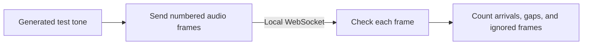

# Phantom Audio Lab

**Test an audio stream before you buy or connect a microphone.**

Send a known tone over a local WebSocket and see what arrives. Find missing frames, spot duplicates, and check a fresh connection without recording anyone.

For developers building microphone devices, DIY audio tools, or audio services. Python, one dependency, no hardware or account.

[](https://github.com/rodneyg/phantom-audio-lab/actions/workflows/ci.yml)

## What it helps you build

| Your project | Start here |
| --- | --- |
| A Wi-Fi microphone | Learn a small audio packet format and how to track missing frames before writing device code. |
| An audio receiver | Test delivery with the same known signal on every run. |
| A bug report or regression test | Reproduce the connection problem with generated audio instead of private conversations. |
| Your own audio tool | Reuse the MIT-licensed sender, receiver, and packet checks. Add your own capture or processing later. |



The lab checks delivery. It does not tell you whether a real microphone, radio, speech model, or sound classifier works.

## Run the three-second demo

Python 3.11 or later. Commands below are for macOS or Linux.

**Terminal 1:** install and start the receiver.

```sh
git clone https://github.com/rodneyg/phantom-audio-lab.git
cd phantom-audio-lab
python3 -m venv .venv
.venv/bin/python -m pip install -r requirements.txt
.venv/bin/python receiver.py
```

**Terminal 2:** open the same folder and send a tone.

```sh
.venv/bin/python sender.py --seconds 3
```

The sender prints `Sent 94 generated tone frames.` The receiver prints:

```json
{"packets": 94, "missing": 0, "ignored": 0, "peak_rms": 0.064913}
```

| Field | Meaning |
| --- | --- |
| `packets` | Frames accepted. Expect 94 for this demo. |
| `missing` | Frames skipped between accepted sequence numbers. Expect 0. |
| `ignored` | Duplicate or old frames ignored. Expect 0. |
| `peak_rms` | Highest measured audio level. A nonzero value confirms samples contain a signal. |

Run the sender again to test another connection. Stop the receiver with Ctrl+C. Both tools accept `--port`; `receiver.py --seconds 10` stops itself after ten seconds.

## Small enough to follow

| File | What it does |
| --- | --- |
| [sender.py](sender.py) | Creates a 440 Hz tone and sends numbered frames at 32 ms intervals. |
| [receiver.py](receiver.py) | Validates incoming frames and prints a delivery report. |
| [protocol.py](protocol.py) | Defines 16 kHz mono PCM packets and sequence tracking. |
| [tests/test_lab.py](tests/test_lab.py) | Checks gaps, duplicates, old frames, fresh connections, invalid packets, and wraparound. |
| [Hardware notes](docs/HARDWARE.md) | Lists references and pins for the exact ReSpeaker Lite kit. No flashing is included. |

[Packet format](docs/PROTOCOL.md) · [Security](SECURITY.md).

## Check your changes

```sh
.venv/bin/python -m unittest discover -s tests -v
```

The tests use generated audio and real local WebSockets. They do not use a microphone, cloud account, model, API key, or product checkout.

Useful contributions: a small reproducible failure case, cross-platform fixes, clearer examples, and hardware notes checked against official sources. [Open an issue](https://github.com/rodneyg/phantom-audio-lab/issues) or [send a pull request](CONTRIBUTING.md). Keep examples and reports free of private audio and credentials.

## Scope and license

This is the standalone community audio lab associated with Phantom. It is not the consumer product, a product client, or a way to access anyone's recordings. The product's dashboard, accounts, cloud service, recording history, and private source are separate. Contributions are reviewed; nothing syncs into the product automatically.

The receiver listens only on `127.0.0.1:8799`. Transport is unencrypted. Audio is generated, checked, then discarded; it is not captured from a microphone, saved, or played. Read [Security](SECURITY.md) before adapting the code for networked use.

[MIT license](LICENSE) · [Third-party notices](THIRD_PARTY_NOTICES.md) · [Contributing](CONTRIBUTING.md).
