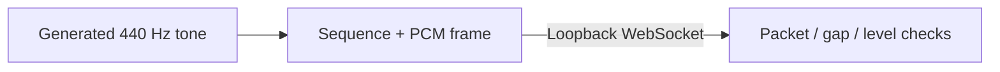

# Phantom Audio Lab

A small audio transport lab for developers working with room microphones. Learn PCM framing, sequence numbers, dropped packets, and reconnection using generated tones. No hardware needed.



## Run

Use Python 3.11 or later. Run these commands from this directory:

```sh
python3 -m venv .venv
.venv/bin/python -m pip install -r requirements.txt
.venv/bin/python receiver.py
```

In another terminal:

```sh
.venv/bin/python sender.py --seconds 3
```

The receiver prints a JSON summary when each connection ends. Expect 94 packets, no missing frames, and a nonzero `peak_rms`. Run the sender again to test a fresh connection. Stop the receiver with Ctrl+C. `--port` selects a different port on both commands; `receiver.py --seconds 10` stops automatically.

## Test

```sh
.venv/bin/python -m unittest discover -s tests -v
```

Tests include real loopback WebSockets, generated audio, reconnection, gaps, duplicates, invalid packets, and sequence wraparound.

[Protocol](docs/PROTOCOL.md) · [ReSpeaker Lite hardware notes](docs/HARDWARE.md) · [Contributing](CONTRIBUTING.md) · [Security](SECURITY.md)

This standalone MIT-licensed lab does not include the Phantom product, recording, transcription, sound classification, pairing, cloud services, or product firmware. It never captures a microphone or stores audio. It has no product endpoints or product integration. The lab uses unencrypted loopback transport only. No product repository history or data belongs here.
