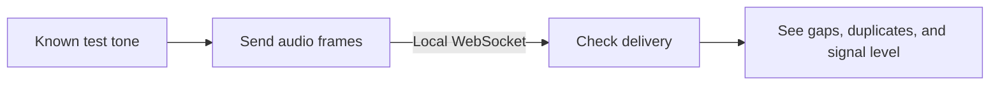

# Phantom Audio Lab

**Build and test an audio stream before your microphone arrives.**

Send a known test tone over a local WebSocket. See which audio frames arrive, count missing frames, and check what happens when a connection starts over.

For developers building microphone devices, DIY audio projects, or local audio services. Runs on your computer with Python and one dependency. No hardware, account, API key, or cloud service needed.

[](https://github.com/rodneyg/phantom-audio-lab/actions/workflows/ci.yml)

## Why use it?

| What you want to do | What the lab gives you |
| --- | --- |
| Start before the hardware is ready | A working sender and receiver you can run on one computer. |
| Understand gaps in an audio stream | Counts of missing frames and ignored duplicate or stale frames. |
| Reproduce a bug without sharing conversations | The same generated tone on every run, with no microphone recordings. |
| Build your own audio connection | Small, MIT-licensed Python files to read, reuse, and adapt. |

The test tone gives you a known signal while you work on delivery. Hardware capture, transcription, and other processing can come later in your own project.



## Try the three-second demo

Use Python 3.11 or later. These commands are for macOS or Linux:

```sh
git clone https://github.com/rodneyg/phantom-audio-lab.git
cd phantom-audio-lab
python3 -m venv .venv
.venv/bin/python -m pip install -r requirements.txt
.venv/bin/python receiver.py
```

From the same folder in another terminal:

```sh
.venv/bin/python sender.py --seconds 3
```

The sender prints:

```text
Sent 94 generated tone frames.
```

The receiver reports:

```json
{"packets": 94, "missing": 0, "ignored": 0, "peak_rms": 0.064913}
```

All 94 frames arrived. None were missing or ignored. The nonzero signal level confirms the frames contained audio samples.

Run the sender again to check a fresh connection. Stop the receiver with Ctrl+C. Both commands accept `--port`; `receiver.py --seconds 10` stops automatically.

## Catch regressions in your changes

```sh
.venv/bin/python -m unittest discover -s tests -v
```

The tests use real local WebSockets and generated audio. They cover fresh connections, missing frames, duplicate and stale frames, invalid packets, and sequence-number wraparound. Adapt them as you change the sender, receiver, or packet format.

## Where to start

- **Building a microphone device:** use [the packet format](docs/PROTOCOL.md) as a starting point for your own device and host code.
- **Learning audio streaming:** follow `sender.py` and `receiver.py` from tone generation to the delivery report.
- **Contributing a fix:** add a failure case, improve cross-platform behavior, or check [hardware notes](docs/HARDWARE.md) against official sources.

[Open an issue](https://github.com/rodneyg/phantom-audio-lab/issues) or [send a pull request](CONTRIBUTING.md). Use generated audio in examples and bug reports.

[Protocol](docs/PROTOCOL.md) · [ReSpeaker Lite hardware notes](docs/HARDWARE.md) · [Contributing](CONTRIBUTING.md) · [Security](SECURITY.md)

**Scope:** this is a local audio transport reference. It generates tones and reports delivery; it does not capture a microphone, save or play audio, or connect to the Phantom product. Transport is unencrypted and restricted to loopback. See [Security](SECURITY.md) before adapting it for other uses.
