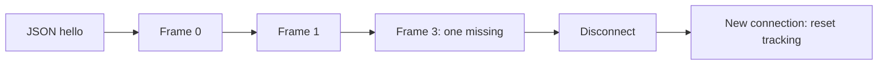

# PCM transport

This lab demonstrates the basic framing used by a room microphone. Its standalone receiver accepts only the strict lab format below. It is not a product API or provisioning client.

1. Open `ws://127.0.0.1:8799` without a browser Origin header.
2. Send this JSON text message:

```json
{"device":"lab-tone","room":"Test lab","rate":16000,"format":"s16le"}
```

Only these four fields are accepted. Device and room are 1–64 characters without control characters. Hello must arrive within five seconds.

3. Send binary messages at 32 ms intervals:

| Bytes | Value |
| --- | --- |
| 0–3 | Unsigned 32-bit sequence, little-endian |
| 4–1027 | 512 mono signed 16-bit PCM samples, little-endian |



At 16,000 samples/second this is 32,000 audio bytes/second, plus framing. Sequence wraps from 4,294,967,295 to zero. A positive forward difference smaller than 2³¹ is accepted. Duplicates, stale frames, and the ambiguous half-range difference are ignored. Gaps are counted; this lab neither inserts silence nor retains missing audio. Tracking starts fresh for every connection, including after a device reboot.

Invalid hello/frame content closes the connection with WebSocket code 1008. Messages larger than 2,048 bytes are rejected by the WebSocket library. The receiver keeps counters and a peak RMS level in memory, prints a summary, then discards them. PCM is never saved or played.
